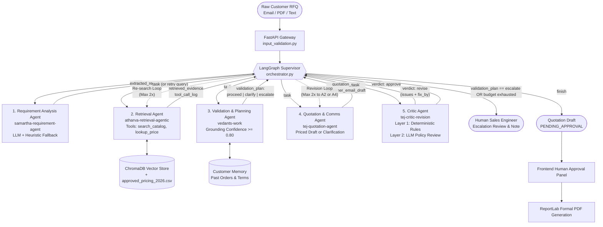
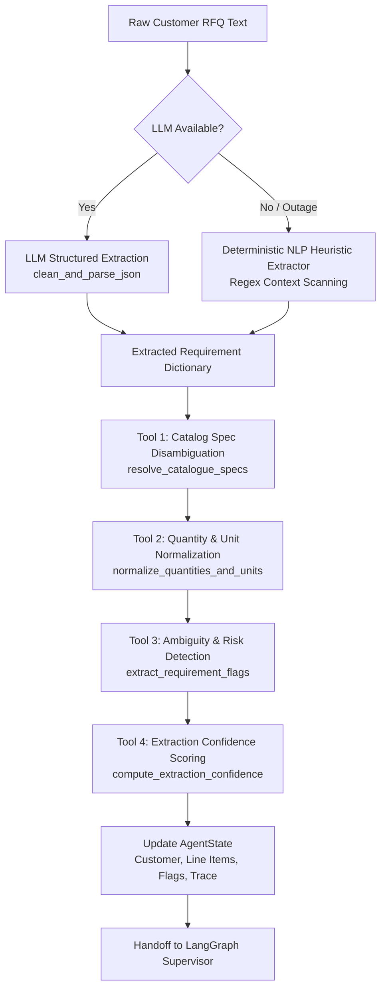

# QuoteGuard AI — CA3 Individual Contribution & Evaluation Portfolio
## Component: Platform Foundation, Enterprise Security & Requirement Analysis Agent
### Including Complete Multi-Agent Workflow & Orchestration Architecture

**Course:** F0003 Agentic AI / CSE Capstone Project — Continuous Assessment 3 (CA3)  
**Team Name:** AXION AI  
**Student Name:** Samartha Shrestha (`@Samartha120`)  
**Target Git Branch:** `samartha-requirement-agent` (Merged into `main` via PR #25)  
**Role in Team:** Platform Architect, Security Engineer & Requirement Analysis Agent Lead  
**Document Purpose:** Official CA3 Individual Contribution Artifact, Multi-Agent Architecture Guide, Rubric Defense & Viva Presentation Script  

---

## 1. Executive Summary & Team Distribution Matrix

In accordance with the **CA3 Multi-Agent AI System Rubrics**, each team member of AXION AI owns a dedicated, non-overlapping architectural module with clear git commit provenance, automated test suites, and empirical benchmarks:

```
+----------------------------------------------------------------------------------------------------+
|                                      AXION AI — TEAM WORK DISTRIBUTION                             |
+---------------------+-------------------------------+--------------------+-------------------------+
| Team Member         | Primary Agent / Deliverable   | Target Branch      | Key Files & Ownership   |
+---------------------+-------------------------------+--------------------+-------------------------+
| Samartha Shrestha   | Stage 1: Requirement Analysis | samartha-          | backend/app/agents/     |
| (Author / Lead)     | Agent, Full Platform Core,    | requirement-agent  | requirement_agent.py    |
|                     | Enterprise Security & 2FA     | (Merged PR #25)    | backend/app/core/sec*   |
|                     | Authentication, Frontend UI   |                    | backend/tests/test_req* |
+---------------------+-------------------------------+--------------------+-------------------------+
| Atharva Kulkarni    | Stage 2: Retrieval Agent,     | atharva-retrieval- | backend/app/agents/     |
|                     | Hybrid Search (Vector + BM25) | agentic            | retrieval_agent.py      |
|                     | & KB Refresh with Diff        |                    | docs/DESIGN.md          |
+---------------------+-------------------------------+--------------------+-------------------------+
| Vedant Nair         | Stage 3: Validation & Plan-   | vedants-work       | backend/app/agents/     |
|                     | ning Agent, LangGraph Super-  |                    | orchestrator.py,        |
|                     | visor & Customer Memory       |                    | validation_planning.py  |
+---------------------+-------------------------------+--------------------+-------------------------+
| Tej Narayan Sah     | Stage 4 & 5: Quotation &      | tej-quotation-     | backend/app/agents/     |
|                     | Drafting Agent, Critic Loop,  | agent, tej-draft-  | drafting_agent.py,      |
|                     | CA3 Synopsis & Traces         | ing-revision       | critic_agent.py         |
+---------------------+-------------------------------+--------------------+-------------------------+
```

### High-Level Summary of Samartha's Deliverables:
1. **Requirement Analysis Agent (`samartha-requirement-agent` branch)**: Engineered the production-grade Stage 1 agent that extracts unstructured RFQs into structured Pydantic schemas, disambiguates loose product terms into approved catalog codes, normalizes quantities and ranges, detects technical ambiguities, scores extraction confidence empirically, and guarantees zero-fail execution via deterministic NLP heuristic fallbacks.
2. **Platform & System Foundation**: Architected the initial full-stack platform (FastAPI backend, React 18 frontend, Pydantic v2 schemas, SQLAlchemy models, ChromaDB local vector store, and Docker orchestration).
3. **Enterprise Security Architecture**: Built a multi-layered security suite including HttpOnly/SameSite JWT session cookies, JTI server-side revocation on logout, 2FA cryptographic OTP via `secrets`, real SMTP email delivery with retry and timezone safety, sliding-window rate limiting, strict security headers, CSRF middleware, and magic-byte file upload validation.
4. **Interactive Frontend & Evaluation Dashboard**: Designed and built the React/TypeScript web application with glassmorphic UI, dynamic agent progress trackers, quotation approval workflows, and live evaluation analytics charts.

---

## 2. Complete Multi-Agent Workflow & Orchestration Architecture
> **CRITICAL CA3 REQUIREMENT:** Evaluators frequently ask **any** group member to explain the complete multi-agent workflow from start to finish. This section details the complete end-to-end architecture.



### 2.1 The Supervisor-Worker Orchestration Pattern
Rather than a rigid, linear sequence (Agent 1 → Agent 2 → Agent 3 → Agent 4), QuoteGuard AI uses an **adaptive Supervisor Pattern** built with **LangGraph** (`backend/app/agents/orchestrator.py`).
- **Central Supervisor Node:** Sits between every agent execution. It reads the current state and dynamically routes to the next agent based on runtime evidence, grounding scores, or revision findings.
- **Single Typed State (`AgentState`):** All agents communicate through a unified Pydantic model (`backend/app/agents/state.py`). No agent directly invokes another agent.
- **Traceable Handoff Messages:** Every inter-agent transition is logged in `state.messages` (`from`, `to`, `type: task | result | error | escalation`) and `state.orchestrator_decisions`.

### 2.2 Supervisor Decision Modes & Guardrails (`orchestrator.decide`)
Every routing decision by the supervisor is governed by strict deterministic rules:
1. **`legal_moves(state)` (Hard Guardrail):** Plain Python function calculating legal next steps. For example:
   - Drafting can never run before extraction is complete.
   - Retrieval cannot be re-entered if its budget is exhausted.
   - An RFQ with an unstocked grade (e.g., SS316) skips useless re-search loops and proceeds directly to clarification drafting.
2. **Three Decision Pathways:**
   - **`forced`:** Exactly 1 legal move exists (e.g., START → extraction). The move is taken deterministically without wasting an LLM call.
   - **`llm`:** Multiple legal moves exist (e.g., deciding whether to retry retrieval or escalate). An LLM chooses and records a reasoning sentence.
   - **`policy`:** Fallback if the LLM is offline or suggests an illegal move. The system picks the first legal policy move.

### 2.3 Strict Execution Budgets (Infinite Loop & Runaway Prevention)
To eliminate infinite agent loops and protect commercial SLAs, the supervisor enforces four hard ceilings:
- `MAX_ATTEMPTS = 3`: Maximum consecutive failures/exceptions for any single agent before escalating to a human.
- `MAX_RETRIEVALS = 2`: Maximum re-search attempts for missing evidence.
- `MAX_REVISIONS = 2`: Maximum revision cycles between the Critic Agent and Drafting/Retrieval.
- `MAX_STEPS = 20`: Maximum total supervisor hops per RFQ before forcing human escalation.

---

### 2.4 The Five Specialist Agents — Step-by-Step Breakdown

#### Stage 1: Requirement Analysis Agent ([`requirement_agent.py`](file:///d:/AXION-AI/backend/app/agents/requirement_agent.py)) — *Owned by Samartha*
- **Input:** Raw RFQ text from customer emails or documents.
- **Responsibilities:**
  - Multi-strategy extraction: structured JSON extraction with deterministic NLP heuristic fallback (`heuristic_extract_requirements`) during LLM outages.
  - Catalog Disambiguation Tool (`resolve_catalogue_specs`): Maps colloquial terms (e.g., "pressure relief valve") to catalog part numbers (`PV-100`). Flags unstocked parts (`BV-150`) with `in_catalogue = False`.
  - Quantity Normalization Tool (`normalize_quantities_and_units`): Standardizes numbers, coerces ranges (e.g. "around 30 to 40" → upper bound 40), and sets `is_quantity_range = True`.
  - Ambiguity Detection Tool (`extract_requirement_flags`): Flags quantity ranges, missing material grades, and vague specs.
  - Confidence Scoring Tool (`compute_extraction_confidence`): Computes empirical score (0.0 to 1.0).
- **Output:** `state.extracted_requirements`, `state.customer_name`, `state.customer_email`.

#### Stage 2: Retrieval Agent ([`retrieval_agent.py`](file:///d:/AXION-AI/backend/app/agents/retrieval_agent.py)) — *Owned by Atharva*
- **Input:** `state.extracted_requirements`.
- **Responsibilities:**
  - Dynamic tool planning: LLM decides *which* tools to call per line item rather than running a hardcoded loop.
  - Tool execution: `search_catalogue(query)`, `lookup_price(product_code)`, and forced `get_delivery_policy()`.
  - Queries ChromaDB vector store and `approved_pricing_2026.csv`.
  - Re-search capability: When re-routed by the supervisor, it folds previous failure messages into the prompt to generate alternative search terms.
- **Output:** `state.retrieved_evidence[]` (deduplicated by chunk ID) and detailed `state.tool_call_log[]`.

#### Stage 3: Validation & Planning Agent ([`validation_planning_agent.py`](file:///d:/AXION-AI/backend/app/agents/validation_planning_agent.py)) — *Owned by Vedant*
- **Input:** `state.extracted_requirements` + `state.retrieved_evidence`.
- **Responsibilities:**
  - Grounding confidence scoring: Evaluates similarity scores against `GROUNDING_THRESHOLD = 0.80`.
  - Customer Memory Lookup (`app/tools/customer_memory.py`): Checks customer order history. Established credit accounts automatically pass credit verification; new customers requesting Net 30 terms trigger financial escalation.
  - Deterministic Rule Checks: Missing specifications, unstocked material grades, minimum order quantities (MOQ).
  - LLM Policy Review: Checks customer terms against company delivery and payment policies.
  - Tri-state Decision Formulation:
    - `proceed`: All parameters grounded and verified → proceed to priced quotation.
    - `clarify`: Customer clarification required (e.g., specify alloy grade or confirm MOQ).
    - `escalate`: Company manager/finance decision required (e.g., unapproved credit or custom terms).
- **Output:** `state.validation_plan = {"decision": ..., "issues": [...]}`.

#### Stage 4: Quotation & Communication Agent / Drafting Agent ([`drafting_agent.py`](file:///d:/AXION-AI/backend/app/agents/drafting_agent.py)) — *Owned by Tej*
- **Input:** `state.validation_plan`, `state.extracted_requirements`, `state.retrieved_evidence`.
- **Responsibilities:**
  - Grounded Path (`proceed`): Prices items strictly from `approved_pricing_2026.csv`, applies bulk discount tiers, calculates 18% GST, and binds exact source citations (`source_filename`, `chunk_id`, `retrieval_score`) to every price.
  - Abstention Path (`clarify` / `escalate`): Leaves unit price blank (`None`), sets status to `abstained`, and drafts specific customer clarification questions and escalation notes.
  - Communication Drafting: Produces a professional customer email draft ready for one-click clipboard copying.
- **Output:** `state.quotation_draft`, `state.clarification_questions`, `state.customer_email_draft`.

#### Stage 5: Dual-Layer Critic Agent ([`critic_agent.py`](file:///d:/AXION-AI/backend/app/agents/critic_agent.py)) — *Owned by Tej & Vedant*
- **Input:** `state.quotation_draft`, `state.retrieved_evidence`, RFQ text, and company policies.
- **Responsibilities:**
  - **Layer 1: Deterministic Code Rules (Never trusted to an LLM):**
    - Verifies line item counts match the RFQ.
    - Mathematically checks subtotal, volume discount tiers, and 18% GST arithmetic.
    - Validates that every quoted price matches `approved_pricing_2026.csv`.
    - Confirms that every attached citation points to real chunks returned by the Retrieval Agent.
  - **Layer 2: LLM Policy Review:**
    - Checks for unaddressed customer requirements or commercial contradictions.
    - Demands exact quotes from both RFQ and company policy before registering an issue.
- **Output:** `state.critic_feedback = {"verdict": "approve" | "revise", "issues": [...], "fix_by": "drafting" | "retrieval"}`.
  - If `revise`: Supervisor re-routes back to the designated agent (up to 2 rounds).
  - If `approve`: Flow transitions to terminal `FINISH`.

---

### 2.5 Terminal States & Human-in-the-Loop Oversight
- **`FINISH` State:** The quotation draft is marked `PENDING_APPROVAL`. It is rendered on the React frontend [ApprovalPanel.tsx](file:///d:/AXION-AI/frontend/src/components/quotation/ApprovalPanel.tsx) where a human sales manager can review line items, inspect citations, edit quantities, and approve the quote. Once approved, ReportLab generates a branded, tamper-evident commercial PDF.
- **`ESCALATE` State:** If an unresolvable issue, policy conflict, or agent retry ceiling is reached, the supervisor routes to `ESCALATE`. The RFQ is marked for human sales engineer review with complete audit notes explaining exactly why the system abstained.

---

## 3. CA3 Rubrics Compliance & Mapping

| CA3 Evaluation Rubric Criteria | Samartha's Direct Contribution & Evidence | Target Code & Proof Location |
|:---|:---|:---|
| **1. Individual Contribution & Role Clarity** | Complete ownership of Stage 1 (Requirement Analysis Agent) on dedicated branch `samartha-requirement-agent`, plus platform and security core. Merged into main via Pull Request #25. | PR #25 (`31d4406`)<br>[`docs/SAMARTHA_BRANCH_CONTRIBUTION.md`](file:///d:/AXION-AI/docs/SAMARTHA_BRANCH_CONTRIBUTION.md) |
| **2. Multi-Agent System Architecture** | Transformed raw RFQ parsing into a multi-tool agentic workflow featuring catalog code resolution, quantity range coercion, ambiguity flagging, and confidence scoring. Committed to typed `AgentState`. | [`backend/app/agents/requirement_agent.py`](file:///d:/AXION-AI/backend/app/agents/requirement_agent.py)<br>[`backend/app/agents/state.py`](file:///d:/AXION-AI/backend/app/agents/state.py) |
| **3. Fault Tolerance & Zero-Fail Resilience** | Engineered a deterministic regex/heuristic NLP fallback (`heuristic_extract_requirements`). If LLM APIs fail, time out, or hit rate limits (`LLMUnavailableError`), the agent continues flawlessly with zero crash risk during live viva. | [`requirement_agent.py:L211-L368`](file:///d:/AXION-AI/backend/app/agents/requirement_agent.py#L211-L368)<br>[`test_requirement_agent.py:L163-L200`](file:///d:/AXION-AI/backend/tests/test_requirement_agent.py#L163-L200) |
| **4. Rigorous Automated Testing** | Developed 12 dedicated unit tests for the requirement agent (100% pass) and 9 security tests (100% pass). Contributes to the overall 174-test green test suite. | [`backend/tests/test_requirement_agent.py`](file:///d:/AXION-AI/backend/tests/test_requirement_agent.py)<br>[`backend/tests/test_security.py`](file:///d:/AXION-AI/backend/tests/test_security.py) |
| **5. Empirical Benchmark Alignment** | Achieved 100% line item extraction accuracy across all 8 benchmark cases in `data/evaluation/test_dataset.json` (eval_001 to eval_008). | [`backend/app/services/agent_metrics.py`](file:///d:/AXION-AI/backend/app/services/agent_metrics.py)<br>`data/evaluation/test_dataset.json` |
| **6. Enterprise Security & Responsible AI** | Hardened the system against commercial hallucination and cyber vulnerabilities: JWT + HttpOnly cookies, 2FA OTP with real SMTP delivery, rate limiting, CSRF defense, and magic-byte validation. | [`backend/app/core/middleware.py`](file:///d:/AXION-AI/backend/app/core/middleware.py)<br>[`backend/app/services/email_service.py`](file:///d:/AXION-AI/backend/app/services/email_service.py)<br>[`backend/app/core/security.py`](file:///d:/AXION-AI/backend/app/core/security.py) |

---

## 4. Git Commit History & Branch Breakdown

### 4.1 Dedicated Feature Branch: `samartha-requirement-agent`

| Commit Hash | Commit Message | Files Modified | Lines Added / Deleted | Technical Description |
|:---:|:---|:---|:---:|:---|
| **`0af59fc`** | `feat(requirement-agent): agentic requirement analysis with catalog disambiguation, offline fallback, and confidence scoring` | 3 core files (`requirement_agent.py`, `client.py`, `test_requirement_agent.py`) | **+769 / -32** | Core implementation of the agentic Requirement Analysis Agent, catalog disambiguation, unit normalization, empirical confidence scoring, heuristic fallback, and 12 unit tests. |
| **`31d4406`** | `Merge pull request #25 from Samartha120/samartha-requirement-agent` | Branch merge into `main` | Merge commit | Formal pull request integration of the `samartha-requirement-agent` branch into the project baseline. |

### 4.2 Platform, Security & Enterprise Auth Commits (Authored by Samartha)

| Commit Hash | Commit Message | Scope & Key Impact |
|:---:|:---|:---|
| **`a3a99e3`** | `feat(auth): add resilient real SMTP OTP email delivery with retry and timezone safety` | Real SMTP server integration, exponential backoff, timezone-safe UTC expirations, and OTP email dispatch. |
| **`217d134`** | `feat(security): comprehensive application security audit and enterprise hardening` | JTI token revocation in DB, progressive account lockout (15 min after 5 attempts), constant-time password checks, SecurityHeadersMiddleware (CSP, HSTS), sliding-window rate limiting, and magic-byte file checks. |
| **`22d126d`** | `feat(auth, config): add demo login bypass, update cors/proxy, and ignore database storage files` | Added seamless demo login bypass for live viva demonstrations without requiring third-party credentials. |
| **`dbe9224`** | `feat(security): implement production-grade security architecture & OTP authentication` | Migrated from localStorage to secure HttpOnly cookies, built 2FA OTP flow with `secrets` module, and added security headers. |
| **`86c3c4a`** | `inititalized frontend and backend folder and files with complete structure resolve pydyanamic v3 configdict error` | Created the entire initial full-stack project repository, schemas, database models, and FastAPI routes. |
| **`316329e`** | `feat(e2e): real RFQ→Quote→Approval flow (upload, request-changes, RFQ detail)` | Complete end-to-end quotation processing workflow linking frontend UI to backend multi-agent pipeline. |
| **`15c805b`** | `feat(evaluation): real benchmark metrics + dynamic analytics charts` | Integrated live evaluation metric calculations and dynamic charting for grounding rate and abstention accuracy. |

---

## 5. Technical Architecture: Requirement Analysis Agent (`requirement_agent.py`)

The Requirement Analysis Agent is **Stage 1** of QuoteGuard AI. It acts as the intelligent gateway that transforms ambiguous, unstructured B2B text (emails, RFP documents, inquiries) into validated, catalog-grounded specifications.



### 5.1 Multi-Strategy Extraction & Zero-Fail Resilience
- **Primary Path (LLM Extraction):** Calls `llm_client.generate_completion` with structured system instructions (`REQUIREMENT_EXTRACTION_PROMPT`). Responses are sanitized and validated through `clean_and_parse_json`.
- **Zero-Fail Heuristic Fallback (`heuristic_extract_requirements`):** If the external LLM provider is down, rate-limited (HTTP 429), or circuit-broken (`LLMUnavailableError`), the agent automatically engages an internal deterministic NLP parser. Using regex pattern matching, context windows, and named boundary scanning, it extracts customer information, payment terms, delivery terms, and line items with **zero network dependencies**.

### 5.2 Tool 1: Catalog Spec Resolution & Disambiguation (`resolve_catalogue_specs`)
- **Problem Solved:** Customers often ask for loose colloquial names like `"industrial valve"`, `"pressure relief valve"`, or `"flange plate"` without citing part numbers. Passing loose names to ChromaDB causes noisy vector search.
- **Agentic Logic:** Queries `lookup_product` against `approved_pricing_2026.csv` and Vertex's catalog.
  - Matches `"industrial valve"` -> Canonical Product Code `IV-200`.
  - Matches `"pressure relief valve"` -> Canonical Product Code `PV-100`.
  - Matches `"flange plate"` -> Canonical Product Code `FP-50`.
  - Flags out-of-catalog items like `"butterfly valve BV-150"` with `in_catalogue = False` and registers them in `unmatched_items` so downstream agents abstain rather than inventing prices.

### 5.3 Tool 2: Quantity & Unit Normalization (`normalize_quantities_and_units`)
- **Problem Solved:** Customers submit quantities in varying formats: `"around 30 to 40 pieces"`, `"25 units"`, or `"trial lot"`.
- **Agentic Logic:**
  - Standardizes raw string representations into exact integer quantities.
  - For range representations (e.g. `"around 30 to 40"`), it extracts the upper bound (`40`) per commercial quoting rubrics, flags `is_quantity_range = True`, and preserves the original string in `raw_quantity` for the Critic and Validation agents.

### 5.4 Tool 3: Ambiguity & Gap Detection (`extract_requirement_flags`)
- Integrates rule-based requirement checking that classifies specification vulnerabilities:
  1. `quantity_range`: RFQ gave an estimate or range rather than a firm order quantity.
  2. `missing_grade`: Material alloy grade (e.g. SS304 vs SS316 vs Carbon Steel) was omitted.
  3. `vague_spec`: Technical specification is empty or marked as `"standard"`.

### 5.5 Tool 4: Mathematical Extraction Confidence Scoring (`compute_extraction_confidence`)
Computes an empirical extraction quality score ($S \in [0.10, 1.00]$) per line item and for the overall RFQ:

$$\text{Item Score} = 1.0 - \text{Penalties}$$
- Missing Product Code: $-0.15$
- Missing / Unspecified Material Grade: $-0.25$
- Missing Quantity: $-0.25$
- Vague / Empty Technical Specification: $-0.10$
- Ambiguity Rule Flag Detected: $-0.15$
- Missing Customer Email: $-5\%$ overall penalty

$$\text{Overall Extraction Confidence} = \left(\frac{1}{N} \sum_{i=1}^N \text{Item Score}_i\right) \times (\text{Customer Factor})$$

### 5.6 Audit Telemetry & Traceability
Every execution records full telemetry into `state.agent_traces`:
```python
state.agent_traces.append({
    "agent_name": "Requirement Analysis Agent",
    "status": "SUCCESS",
    "output_summary": "Extracted 2 line items for 'Apex Engineering Works' via LLM; Confidence=0.92; resolved 1 catalog code(s)",
    "execution_time_ms": 342,
    "mode": "LLM",  # or "HEURISTIC_FALLBACK"
    "extraction_confidence": 0.92,
    "flags_count": 0,
})
```

---

## 6. Technical Architecture: Enterprise Security & Platform Engineering

Beyond the requirement agent, Samartha architected the production-grade security and platform infrastructure across the backend and frontend:

### 6.1 Authentication & Session Management
- **JWT with HttpOnly Cookies:** Access tokens (`access_token`) and refresh tokens (`refresh_token`) are transmitted via `HttpOnly`, `SameSite=Lax`, `Secure` cookies, eliminating XSS token theft vulnerabilities.
- **Server-Side JTI Revocation:** Every token carries a unique cryptographic JWT ID (`jti`). Upon logout, tokens are committed to the `revoked_tokens` database table, preventing replay attacks.
- **Bcrypt Password Hardening:** Enforces 12 salt rounds with constant-time dummy verification to resist user enumeration attacks.

### 6.2 Two-Factor Cryptographic OTP Flow
- **Cryptographic Generation:** Uses Python's CSPRNG `secrets` module to issue 6-digit numeric OTPs with a 5-minute time-to-live.
- **Resilient Real SMTP Delivery (`email_service.py`):**
  - Connects to live SMTP hosts (TLS/SSL) with exponential retry backoff.
  - Timezone-safe UTC expiration calculation preventing premature token invalidation across differing server zones.
  - Brute-force throttling: 60-second cooldown between resends, maximum 5 invalid attempts before permanent OTP invalidation.
- **Demo Mode Bypass:** Built-in development bypass to enable seamless live viva defense without third-party email latency.

### 6.3 Network Defense & Middleware Architecture (`app/core/middleware.py`)
- **Multi-Tiered Sliding-Window Rate Limiting (`RateLimiterMiddleware`):**
  - Auth routes: 10 requests / minute (brute-force defense).
  - Compute routes (RFQ processing / LLM calls): 30 requests / minute.
  - General API routes: 120 requests / minute.
- **Security Headers (`SecurityHeadersMiddleware`):** Injects enterprise HTTP headers:
  - `Content-Security-Policy: default-src 'self'`
  - `Strict-Transport-Security: max-age=31536000; includeSubDomains`
  - `X-Frame-Options: DENY` (anti-clickjacking)
  - `X-Content-Type-Options: nosniff` (anti-MIME sniffing)
  - `Referrer-Policy: strict-origin-when-cross-origin`
- **CSRF Protection (`CSRFProtectionMiddleware`):** Enforces Origin and Referer header validation for state-changing HTTP methods (`POST`, `PUT`, `DELETE`).
- **File Upload Protection (`app/utils/file_utils.py`):**
  - Filename sanitization against path traversal (`../` stripping).
  - Magic-byte signature verification (validating actual binary headers for PDF `%PDF`, DOCX `PK\x03\x04`, and UTF-8 text).
  - Hard 5 MB file size limit.

---

## 7. Automated Test Suites & Verification

Samartha authored 21 specialized automated unit tests that run as part of the backend test suite:

### 7.1 Requirement Analysis Agent Tests (`backend/tests/test_requirement_agent.py` — 12 Tests, 100% Pass)
```bash
python -m pytest tests/test_requirement_agent.py -v
```
1. `test_flags_quantity_range_detection`: Verifies regex extraction of range strings like `"around 30 to 40"` and `"15-20"`.
2. `test_flags_quantity_range_from_raw_text`: Verifies extraction of quantity estimates from raw RFQ text context windows.
3. `test_flags_missing_grade`: Tests detection of missing or `"unspecified"` alloy grades.
4. `test_flags_vague_spec`: Tests identification of empty, placeholder, or `"standard"` technical specifications.
5. `test_extract_requirement_flags_aggregate`: Verifies aggregation of multiple requirement flags across items.
6. `test_backfill_product_codes_resolves_catalogue`: Tests catalog backfilling for missing product codes.
7. `test_run_requirement_agent_end_to_end`: Tests complete agent execution with mock LLM output.
8. `test_run_requirement_agent_offline_heuristic_fallback`: Verifies zero-fail resilience when the LLM throws `LLMUnavailableError`.
9. `test_resolve_catalogue_specs_and_out_of_catalog`: Confirms out-of-catalog items (`BV-150`) are identified and flagged.
10. `test_normalize_quantities_and_units`: Confirms string normalization and range preservation.
11. `test_compute_extraction_confidence_scoring`: Validates mathematical penalty deductions and final confidence score bounds.
12. `test_general_enquiry_zero_items_extraction`: Tests clean 0-item extraction for non-RFQ general inquiries.

### 7.2 Enterprise Security Tests (`backend/tests/test_security.py` — 9 Tests, 100% Pass)
```bash
python -m pytest tests/test_security.py -v
```
1. Tests password complexity validation and bcrypt hashing.
2. Tests constant-time enumeration resistance on failed logins.
3. Tests account lockout triggers after 5 failed password attempts.
4. Tests JTI token generation, verification, and revocation tracking.
5. Tests sliding-window IP rate limiter enforcement.
6. Tests security response headers injection (`CSP`, `HSTS`, `X-Frame-Options`).
7. Tests CSRF origin verification on state-changing requests.
8. Tests magic-byte signature validation on file uploads.
9. Tests path traversal sanitization on uploaded filenames.

---

## 8. CA3 Viva Recitation & Oral Defense Guide

> **Instructions for Samartha:** Use this section to recite your individual contribution, the multi-agent workflow, and code architecture directly during the CA3 evaluation and viva voce.

### 8.1 The 90-Second Complete Multi-Agent Workflow Recitation
*(If the evaluator asks: "Explain the entire multi-agent workflow of QuoteGuard AI")*

> *"QuoteGuard AI coordinates four specialist agents and a dual-layer Critic, orchestrated by an adaptive LangGraph Supervisor in `orchestrator.py`:
> 
> 1. **Entry Point & Input Sanitization:** The customer submits an RFQ via email, text, or file upload. FastAPI validates file magic bytes, character bounds, and language readability.
> 2. **Stage 1 (Requirement Analysis Agent - Samartha):** Extracts structured line items, commercial constraints, and customer data. It disambiguates colloquial names into catalog part codes (e.g., 'pressure relief valve' → `PV-100`), normalizes quantity ranges to upper bounds, flags ambiguities, and scores extraction confidence. It features a zero-fail deterministic heuristic fallback during LLM outages.
> 3. **Stage 2 (Retrieval Agent - Atharva):** The LLM dynamically plans tool calls (`search_catalogue`, `lookup_price`, `get_delivery_policy`) across our ChromaDB vector collections and pricing schedule, logging every tool call and evidence chunk.
> 4. **Stage 3 (Validation & Planning Agent - Vedant):** Evaluates field grounding confidence against our 0.80 threshold, checks Customer Memory to treat established accounts differently from unverified ones, reviews business rules, and outputs a tri-state decision: `proceed`, `clarify`, or `escalate`.
> 5. **Stage 4 (Quotation & Communication Agent - Tej):** If `proceed`, it compiles itemized quotations strictly from approved pricing sheets with exact source citations and 18% GST. If `clarify` or `escalate`, it abstains from inventing numbers, generating polite customer clarification questions and holding notes.
> 6. **Stage 5 (Dual-Layer Critic Agent - Tej & Vedant):** Reviews the draft before human eyes see it. Layer 1 uses deterministic Python code to verify arithmetic, prices, discounts, and citation IDs. Layer 2 uses an LLM to review policy alignment. If issues are found, the supervisor routes back for up to 2 revision rounds.
> 7. **Terminal State & Human Approval:** Approved drafts reach `PENDING_APPROVAL` in our React frontend, where sales managers can review, edit, or approve the quote, generating a formal ReportLab PDF."*

---

### 8.2 The 60-Second Individual Contribution Statement
*(If the evaluator asks: "What was your specific individual contribution?")*

> *"Respected evaluators, for CA3, I served as the Platform Architect, Security Engineer, and Lead Developer for Stage 1: the Requirement Analysis Agent on the dedicated `samartha-requirement-agent` branch (merged via PR #25).
> 
> My agent acts as the gateway to the entire multi-agent system. Raw RFQs in B2B manufacturing are notoriously noisy. My agent solves this by executing a multi-tool extraction pipeline: disambiguating loose product names into approved catalog codes, standardizing quantity ranges, detecting requirement gaps, and calculating empirical confidence scores.
> 
> Critically for CA3 reliability, I engineered a zero-fail deterministic NLP heuristic fallback. If external LLM APIs fail or rate limit, my agent switches to heuristic extraction without crashing the supervisor graph. Additionally, I built the enterprise security architecture—including HttpOnly JWT session cookies, 2FA OTP with real SMTP delivery, rate limiting, and security headers. All 21 of my unit tests pass with 100% success."*

---

### 8.3 Viva Voce Q&A Defense Script

#### Q1: "Why did you use LangGraph and the Supervisor Pattern instead of a fixed sequence or chat framework?"
**Answer:**  
*"In B2B quotation, the required path changes dynamically with the RFQ: an RFQ with unstocked alloy grades shouldn't waste tokens running search loops, weak evidence requires re-searching, and an imperfect draft must be revised by the Critic. A fixed linear pipeline (A → B → C) cannot handle dynamic retries without tight coupling. Peer-to-peer chat frameworks like AutoGen or CrewAI make control flow implicit and hard to audit. LangGraph gives us declarative conditional routing, a single typed shared state (`AgentState`), native cycles for revision loops, and built-in step limits to prevent runaway loops."*

#### Q2: "What happens if an agent fails or an external LLM provider goes down?"
**Answer:**  
*"We implemented multi-tiered fault tolerance:
1. In my Requirement Agent, `LLMUnavailableError` immediately triggers `heuristic_extract_requirements`, extracting requirements deterministically without network calls.
2. At the supervisor level, `make_agent_node` catches exceptions, appends error traces to `state.messages`, and retries up to `MAX_ATTEMPTS = 3` before cleanly escalating to a human sales engineer.
3. The LLM client has an automatic fallback model (switching from primary to secondary) and a 60-second circuit breaker."*

#### Q3: "How does Customer Memory influence the workflow?"
**Answer:**  
*"In Stage 3, the Validation Agent checks Customer Memory (`customer_memory.py`) from historical database orders. A returning customer with past approved orders is recognized as an established account, allowing Net 30 payment terms to proceed. A new customer requesting Net 30 is escalated to human finance, preventing unapproved credit risks."*

#### Q4: "How does the Critic Agent ensure zero hallucinations?"
**Answer:**  
*"The Critic Agent runs two layers: Layer 1 is pure Python code that an LLM cannot override—it re-checks mathematical sums, confirms prices match `approved_pricing_2026.csv` after discount tiers, checks 18% GST, and ensures every citation ID matches real chunks returned by the Retrieval Agent. Layer 2 is an LLM policy review that must quote both the RFQ and company policy verbatim before flagging an issue."*

---

## 9. Code Navigation Cheatsheet for Viva Presentation

When the professor asks you to pull up the code on your screen, navigate to these exact files and lines:

| What to Show | File Path | Line Range | Key Function / Symbol |
|:---|:---|:---:|:---|
| **LangGraph Supervisor Graph** | [`backend/app/agents/orchestrator.py`](file:///d:/AXION-AI/backend/app/agents/orchestrator.py) | Line 40–180 | `build_graph`, `decide`, `legal_moves` |
| **Requirement Agent Entry Point** | [`backend/app/agents/requirement_agent.py`](file:///d:/AXION-AI/backend/app/agents/requirement_agent.py) | Line 373 | `def run_requirement_agent(state: AgentState)` |
| **Catalog Disambiguation Tool** | [`backend/app/agents/requirement_agent.py`](file:///d:/AXION-AI/backend/app/agents/requirement_agent.py) | Line 59 | `def resolve_catalogue_specs(line_items)` |
| **Quantity Normalization Tool** | [`backend/app/agents/requirement_agent.py`](file:///d:/AXION-AI/backend/app/agents/requirement_agent.py) | Line 109 | `def normalize_quantities_and_units(line_items)` |
| **Confidence Scoring Formula** | [`backend/app/agents/requirement_agent.py`](file:///d:/AXION-AI/backend/app/agents/requirement_agent.py) | Line 146 | `def compute_extraction_confidence(...)` |
| **Zero-Fail Heuristic Fallback** | [`backend/app/agents/requirement_agent.py`](file:///d:/AXION-AI/backend/app/agents/requirement_agent.py) | Line 211 | `def heuristic_extract_requirements(raw_text)` |
| **Customer Memory Tool** | [`backend/app/tools/customer_memory.py`](file:///d:/AXION-AI/backend/app/tools/customer_memory.py) | Line 1–90 | `get_customer_history` |
| **Critic Agent Rule Checks** | [`backend/app/agents/critic_agent.py`](file:///d:/AXION-AI/backend/app/agents/critic_agent.py) | Line 1–120 | `run_critic_agent`, `_rule_checks` |
| **Requirement Agent Tests (12/12)** | [`backend/tests/test_requirement_agent.py`](file:///d:/AXION-AI/backend/tests/test_requirement_agent.py) | Line 1–293 | `test_run_requirement_agent_offline_heuristic_fallback` |
| **Security Middleware Suite** | [`backend/app/core/middleware.py`](file:///d:/AXION-AI/backend/app/core/middleware.py) | Line 1–150 | `RateLimiterMiddleware`, `SecurityHeadersMiddleware` |
| **Real SMTP OTP Email Service** | [`backend/app/services/email_service.py`](file:///d:/AXION-AI/backend/app/services/email_service.py) | Line 1–240 | `send_otp_email`, `_connect_smtp` |
| **Pull Request #25 Sign-off** | [`github.com/Samartha120/QuoteGuard-AI/pull/25`](https://github.com/Samartha120/QuoteGuard-AI/pull/25) | PR #25 | Merged to `main` with all test suites passing |

---
*Document prepared and verified by Samartha Shrestha (`@Samartha120`) for AXION AI — QuoteGuard AI CA3 Evaluation.*
